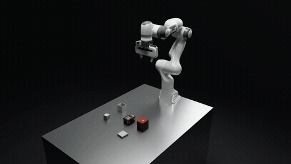
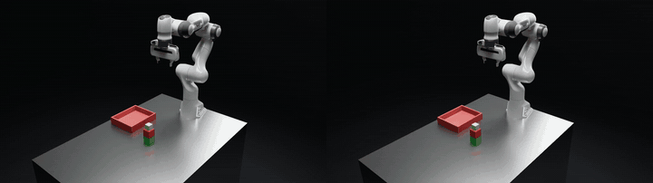
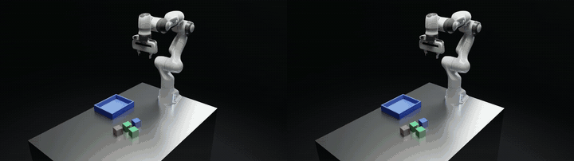
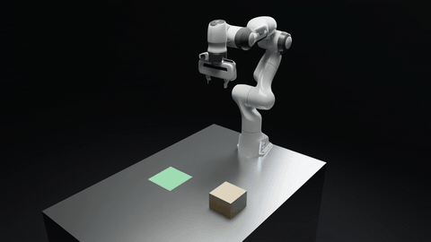
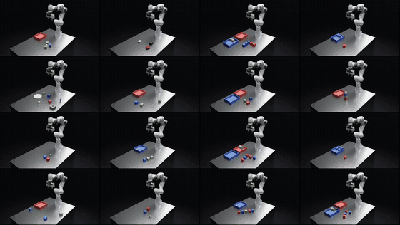

# Intent2Action

[](https://github.com/allwinlucious/Intent2Action/actions/workflows/ci.yml)
[-yellow)](https://huggingface.co/mewbot97/Intent2Action-glimmer-programs)
[-yellow)](https://huggingface.co/mewbot97/Intent2Action-glimmer-recovery)
[-yellow)](https://huggingface.co/mewbot97/Intent2Action-glimmer-push)
[](LICENSE)

**Show a robot a task once, as a short video, a sentence, or both. A fine-tuned open model turns it into explicit
rules and a short, checkable robot program. A person approves, and an industrial robot stack executes it with
collision-checked, force-limited motion.**

<p align="center">
  
  <br><sub>Read from a phone clip of the task, corrected once at the confirm step; the fine-tuned model's program, run in
  Isaac Sim physics (2× speed).</sub>
</p>

The model never moves the robot directly. It writes a program against a small robot API. The runtime checks and
dry-runs the program before anything moves, executes it with a budgeted recovery ladder, and verifies the result
against ground truth. A person signs off at three gates:
1.  confirm the intent;
2.  press Run;
3.  approve every recovery patch.

## In action

| Learning from experience: tower unload | Experience beats size |
|---|---|
|  |  |
| Base Glimmer pulls the bottom cube and fails (left); the fine-tuned model unstacks top first (right). 3× speed. | `cluster:100003`: Muse Wonder's textbook loop finds no feasible grasp on its first pick (left); ours takes the outermost cube first (right). 3.5× speed. |
| **A new skill: + push experience** | **Held-out tasks it passed in Isaac physics** |
|  |  |
| The carton is wider than the gripper opens. G1e says so, asks, and after "can you get it done somehow?" pushes it onto the zone with force-limited moves; every move approved. 10× speed. | Sixteen tasks at once: cluster, mixed, packing, reach and stacking from the 42 Isaac successes, plus Glimmer's sort-by-colour and yellow-on-red and two scripted capability takes (peg in hole, gift tower). 6× speed. |

Every take is recorded at 30 fps in real time (`tools/record_take.py`); the model calls behind them are logged in
[`demo_runs/`](demo_runs).

## Try it

**1. In two minutes, no GPU: the panel with the real recorded model replies.**

```bash
git clone https://github.com/allwinlucious/Intent2Action && cd Intent2Action
make setup        # .venv (Python 3.12)
make ui-replay    # open http://127.0.0.1:8765
```

Choose the scene **Heart box · pack and close** and type `put the small heart box into the open box and close the
lid`. Glimmer's logged reading appears (it misses the lid). Correct it with `the small heart box is a gift, not a box:
the mauve gift goes into the box, then the lid goes on the box`, then confirm, and the fine-tuned model's logged
program appears; press ▶. Every reply comes from `demo_runs/transcript.jsonl`, replayed exactly; only logged requests
can be replayed. The robot is simulated (no physics).

**2. The fine-tuned models themselves**, on any GPU host with about 40 GB and CUDA ≥ 13 (RunPod, Modal, a workstation):

```bash
bash runpod/serve_from_hf.sh                     # base Glimmer + the three adapters from Hugging Face, port 8000
LLM_BASE_URL=http://<gpu-host>:8000/v1 LLM_API_KEY=unused make ui-fake    # the panel, now asking the real models
```

**3. Check the numbers:** `make test` (346 unit tests, about a minute) and `make tables` (rebuilds every results
table from the published data in `results/`).

**4. The full stack** (Intrinsic Core container, Isaac Sim physics): [docs/REPRODUCE.md](docs/REPRODUCE.md).

## Results

The model is Muse Glimmer 30B, fine-tuned with QLoRA on what the robot actually achieved in simulation ("learning
from experience").

| | base Glimmer | fine-tuned (G1d, the one model used) |
|---|---|---|
| Programs that succeed, 250 held-out tasks × 3 runs (planning simulator) | 61% [56–67] | **83% [79–87]** |
| Isaac Sim physics, 50 held-out tasks | 34/50 | **42/50** |
| Live recovery: failed runs rescued, 20 tasks | 4/20 | **9/20** |

Compared with hosted Meta models through the same pipeline (same prompt, temperature 0, one attempt):

| | plan tier, 250 × 3 | Isaac physics, 50 |
|---|---|---|
| Muse Spark 1.3 | 71% [67–76] | 37/50 |
| Muse Wonder | 76% [72–81] | 37/50 |
| **fine-tuned Glimmer 30B (G1d)** | **83% [79–87]** | **42/50** |

The fine-tuned open model beats both:
*   +6.8 points over Wonder (paired 95% [+2.7, +10.9]);
*   +11.5 over Spark 1.3.

The large models write correct programs but do not know what this robot can grasp, for example a cube wedged in a
cluster.

*   Intervals are 95% bootstrap over tasks.
*   The best program writer, G1b, reaches 86% [82–89].
*   References: the best fixed strategy per task family reaches 84%; an oracle that picks the best strategy per
    scene reaches 91%.
*   Every number, the ablations (rejection sampling, DPO, GRPO, bf16 LoRA, seeds), what did not work, and the
    limitations: [docs/designs/learning_results.md](docs/designs/learning_results.md).

**A new skill from experience (G1e = G1d + push experience):**
*   **Training:** pushing objects the gripper cannot hold (crates, trays, totes) onto a goal, with the robot's
    force-limited moves.
*   **Held-out carton and zone, never in training:**
    *   it says it cannot grasp the carton and asks, in 15/15 scenes;
    *   after a yes, it pushes the carton onto the zone in 11/15 (G1d: 0/10).
*   **The cost:** stacking 89 → 58 % (250 tasks: 77 %). Balancing the mix is the next step.
*   Details: [learning_results.md](docs/designs/learning_results.md).

**Trained adapters on Hugging Face**, Apache-2.0, for `meta-models/Muse-Glimmer-30B`:
*   [mewbot97/Intent2Action-glimmer-recovery](https://huggingface.co/mewbot97/Intent2Action-glimmer-recovery) (G1d): writes
    programs and handles recovery. This is the model the demo uses.
*   [mewbot97/Intent2Action-glimmer-push](https://huggingface.co/mewbot97/Intent2Action-glimmer-push) (G1e): G1d +
    push experience, the carton finale.
*   [mewbot97/Intent2Action-glimmer-programs](https://huggingface.co/mewbot97/Intent2Action-glimmer-programs) (G1b): the best
    program writer.

## How it works

```
demo clip / sentence ──► reader (Glimmer, images + text; speech via Muse Voice Transcribe)
                         └► explicit rules ("every cube → into the red box")      ◄── person confirms or corrects
                              └► program writer (fine-tuned Glimmer)
                                   └► short Python program (find / pick / place / verify)  ◄── person presses Run
                                        └► runtime: static check → dry run → execute
                                             ├► robot service (gRPC): Intrinsic Core world model, motion and grasp
                                             │   planning, ICON real-time control ⇄ ROS 2 ⇄ Isaac Sim (Franka)
                                             └► on failure: budgeted recovery (retry / skip / patch / ask / stop)
                                                  └► patches                         ◄── person approves each one
                                                       └► rule checker on simulator ground truth: ✓ / ✗
```

| Part | Where |
|---|---|
| Robot API and runtime (check, dry run, recovery ladder, rules) | [`program_runtime/`](program_runtime) |
| Robot service (gRPC API over Intrinsic Core; Pick, Place, force moves) | [`container/services/`](container/services), [`robot_service/robot_service.proto`](robot_service/robot_service.proto) |
| Intrinsic Core in one container | [`container/`](container) ([README](container/README.md)) |
| Isaac Sim scene, ROS 2 bridge, video look | [`sim/`](sim), [`ros_ws/`](ros_ws) |
| MCP server (every robot RPC as a tool) | [`mcp_server/`](mcp_server) ([README](mcp_server/README.md)) |
| Demo panel (human gates, live view, approvals) | [`demo_ui/`](demo_ui) |
| Learning: task families, expert, training, evaluation | [`learn/`](learn), [`runpod/`](runpod) |
| Designs, plans and results | [`docs/designs/`](docs/designs) |

## Full setup

| Level | Needs | Gives |
|---|---|---|
| Unit tests, fake panel, result tables | Python 3.12 | everything above |
| Planning simulator ("plan tier") | Docker; the Intrinsic Core image (`container/README.md`) | real motion and grasp planning without physics; the evaluation fleet (`learn/fleet.py`) |
| Physics | NVIDIA Isaac Sim 5.1 (Windows host, WSL2 with mirrored networking), an NVIDIA GPU | `tests/e2e/*`, Isaac evaluations, demo takes |
| Models | a GPU with about 40 GB (RunPod, `runpod/setup.sh`) or the Meta Model API | training, generation, the live panel |

Step-by-step commands for every experiment are in [docs/REPRODUCE.md](docs/REPRODUCE.md).

## Repository layout

```
program_runtime/  robot API, runtime, intent reader, rules        demo_ui/      the demo panel
container/        Intrinsic Core container and robot service      sim/          Isaac Sim scene and tools
learn/            task families, expert, SFT/DPO/GRPO, evaluation  runpod/       GPU pod scripts
mcp_server/       MCP tools generated from the proto              tests/        unit tests; tests/e2e: stack checks
results/          published experiment data (restore: make tables) docs/        designs, phase plans, results
```

## Limitations

*   Synthetic tabletop tasks: cubes, boxes and plates, in five generated families.
*   No real robot, no perception noise: the program gets the true object list.
*   The model decides the strategy (the order of picks and places); grasps and motion stay with the robot stack.
*   Physics evaluations cover 50 tasks.
*   This is not certified functional safety. A real cell still needs its own safety layer: guarding, safety-rated
    stops and speed monitoring, and a risk assessment.

## Prior work and what was built

*   **Before 27 October 2026** (the first commit, `d2000c5`, "Snapshot before … implementation"): a build of Intrinsic
    Core packaged in one Docker container (build scripts, Dockerfile, generated protobuf stubs, a motion planner
    config), one early Isaac Sim pick-and-place script, and a plan document. No robot service, models, learning or
    demo.
*   **Built from 27 October to 4 November 2026** (every later commit):
    *   the robot service (gRPC API over Intrinsic Core: pick, place, force moves, calibration) and the ROS 2 bridge
        to Isaac Sim;
    *   the MCP server;
    *   the program runtime (check, dry run, budgeted recovery, rule checker) and the intent reader;
    *   the task families, the search expert and the push experience;
    *   the learning pipeline (SFT, DPO, GRPO, the evaluation fleet, the physics evaluation) and the trained
        adapters;
    *   the hosted-model benchmark;
    *   the demo panel, the textured props and the video renders;
    *   CI.
*   **Third-party work** is credited in [NOTICE](NOTICE).

## License

Apache-2.0 ([LICENSE](LICENSE)); third-party parts keep their own licences ([NOTICE](NOTICE)).
